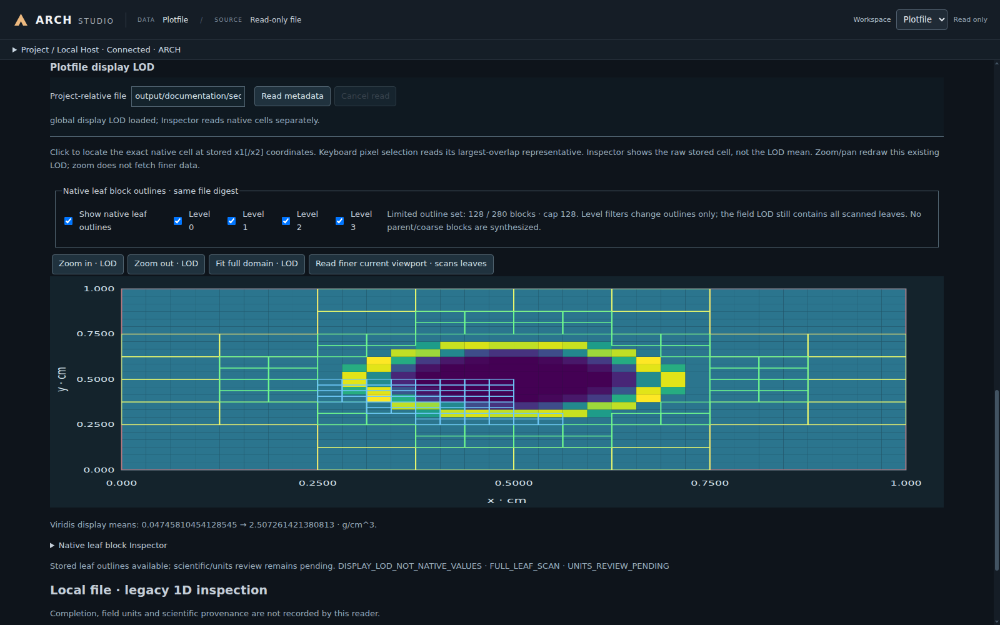

# ARCH: Adaptive Reactive CUDA Hydrodynamics

[简体中文](README.zh-CN.md) · [Documentation](docs/README.md)

[](docs/guides/Build.md)
[](docs/guides/Build.md)
[](https://github.com/Shiro-Akane/ARCH/actions/workflows/ci.yml)
[](docs/CudaBackendStatus.md)
[](LICENSE)

ARCH models compressible fluid motion, heat transfer and nuclear reactions. It uses finite-volume methods and adaptive mesh refinement (AMR) to resolve evolving flow structures. CPU and CUDA share the physics and mathematical implementation.

**Linux is recommended**, including Linux under WSL2. Native Windows 11 x64 also supports the CPU/CUDA command-line program and the complete Studio workflow, but may still have platform-specific instability or bugs. See [platform support](docs/releases/PlatformSupport.md) for tested configurations and limitations. **Studio is optional** for scientific calculations.

## Features and documentation

- One- to three-dimensional fluid dynamics, dynamic AMR and Cartesian, spherical and cylindrical coordinates.
- Ideal-gas and tabulated equations of state, thermal/viscous/species diffusion, nuclear reactions, and external/self gravity.
- CPU/OpenMP and CUDA execution, HDF5 output and compatible checkpoint restart.
- A desktop workbench for parameters, initial previews, builds, runs and output inspection.

The [feature list](docs/Features.md) describes supported combinations. Use the [reference](docs/Reference.md) for parameters and interfaces, and [validation](validation/README.md) for reference problems, numerical errors and convergence.

ARCH uses **CGS units**: length in cm, time in s, density in g/cm³, pressure and energy density in erg/cm³, specific internal energy in erg/g, temperature in K, and angles in rad. Inputs are not converted automatically. The [case guide](docs/guides/SimulationCase.md#units) explains units and output interpretation.

## Build

Prepare the tools and matching libraries using the [Linux/Windows build guide](docs/guides/Build.md). All commands start at the repository root.

| Requirement | Linux / WSL2 | Native Windows 11 x64 |
| --- | --- | --- |
| CPU | C++20 compiler, CMake 3.22+, Ninja, Git, HDF5 C++/HL and OpenMP | GCC/UCRT64 with matching HDF5/KLU dependencies and native CMake/Ninja |
| CUDA | CMake 3.25.2+, CUDA Toolkit 12.0+, compatible host compiler and GPU driver | Separate MSVC/NVCC build with Windows SDK and MSVC-ABI dependencies |
| Optional Studio | Native Node 24+, npm, Electron and graphical session/WSLg | Native x64 Node 24+, npm and Electron |

### Get the source

```bash
git clone --branch main --single-branch https://github.com/Shiro-Akane/ARCH.git
cd ARCH
```

An existing checkout can use `git pull --ff-only` after local changes are saved.

### Option A: CPU

Linux / WSL2, after installing the required tools and libraries:

```text
cmake --preset cpu-release
cmake --build build-cpu --target ARCH --parallel 1
```

On Windows, configure GCC/UCRT64 and its matching libraries with the [CPU build instructions](docs/guides/Build.md#cpu-build), then compile:

```powershell
cmake --build build-windows-cpu --target ARCH --parallel 1
```

The executables are `build-cpu/bin/ARCH` and `build-windows-cpu/bin/ARCH.exe`. Each OS uses its own build directory.

### Option B: CPU and CUDA

Linux / WSL2, on the machine with the GPU that will run the calculation:

```text
cmake --preset cuda-release
cmake --build build-cuda --target ARCH --parallel 1
```

On Windows, configure the separate MSVC/NVCC toolchain using the [CUDA build instructions](docs/guides/Build.md#cuda-build), then compile:

```powershell
cmake --build build-cuda-win --target ARCH --parallel 1
```

This produces `build-cuda/bin/ARCH` or `build-cuda-win/bin/ARCH.exe`, with CPU and CUDA execution available in the same program. Set `compute_backend = cpu`, `cuda` or `auto` in the parameter file. CUDA compilation can require substantial host memory; the build guide covers parallel limits and optional cuDSS for sparse burning.

The first Sod case needs no EOS table. Helmholtz cases need table data: use `git lfs pull` in a checkout, or follow the [source-archive instructions](docs/guides/Build.md#source-archives-and-eos-tables).

## First run

Sod is a small one-dimensional shock tube. Two initially separated gas states produce a shock, contact surface and expanding wave, making it a useful first calculation.

Linux/WSL2:

```bash
export OMP_NUM_THREADS=4
./build-cpu/bin/ARCH Sod simulation/Sod/Sod_beginner.par
```

Windows PowerShell, with the native dependency paths set:

```powershell
$env:OMP_NUM_THREADS = '4'
& .\build-windows-cpu\bin\ARCH.exe Sod simulation/Sod/Sod_beginner.par
```

`Sod` selects the compiled problem definition; the `.par` file supplies its parameters. `OMP_NUM_THREADS` controls CPU worker threads. To use a CUDA-enabled build, select its executable and change the existing `compute_backend` assignment in a copy of the input.

The program prints time-step diagnostics and writes a log, Plotfiles (`*_plt_*.h5`) and restart checkpoints (`*_chk_*.h5`) under `output/first_sod/`. The beginner input uses 64 cells; `simulation/Sod/Sod.par` provides the 128-cell example.

**Paths inside `.par` files resolve from the calculation's working directory, not the parameter file's directory.** Relative paths such as `output/first_sod` work on both systems. Adapt absolute Linux/WSL paths before using the same file on Windows; see [paths in Studio and parameter files](docs/guides/Studio.md#paths-on-linux-and-windows).

Continue with the [Simulation Case Guide](docs/guides/SimulationCase.md) to inspect output, adjust parameters and write `Setup`/`Init` for a new problem.

## ARCH Studio

Studio brings parameter editing, Configure/Build, initial-field and initial-AMR Preview, Run/Restart and read-only Plotfile viewing into one desktop workbench.



*Inspect an evolved density field, display the adaptive mesh and query stored cell values. The [illustrated Studio guide](docs/guides/Studio.md) walks through configuration, preview and output inspection.*

Enable `ARCH_BUILD_STUDIO=ON` when following the [build guide](docs/guides/Build.md). The desktop manages its local connections automatically. Choose a compiled model and parameter file, edit the Working Copy, and save it before Run. The Plotfile workspace opens existing outputs for inspection.

## Extended models

Tabular EOS uses the [table data contract](src/physics/eos/TabularEOS.md). The [generated-network guide](src/physics/network/custom/README.md) explains how to create and register a reaction network. [User boundaries](docs/guides/UserBoundaries.md) covers fluid and potential boundary conditions.

## Repository map

| Directory | Contents |
| --- | --- |
| `include/`, `simulation/` | Public case headers, runnable problems and example inputs |
| `src/` | Shared physics/numerics, mesh, driver, CPU/CUDA execution and I/O |
| `studio/` | Desktop window, local Host service and workbench |
| `EOS_toolkit/` | EOS tables and preparation tools |
| `docs/` | User guides, reference and developer documentation |
| `validation/`, `tests/` | Scientific references and engineering regressions |
| `tools/`, `cmake/` | Build, validation and configuration utilities |

See the [source guide](src/README.md) and [contributor guide](docs/development/README.md) for implementation ownership. Use the [reporting guide](docs/guides/Reporting.md) for a build or numerical problem.

## Citation

For v1.4.0, cite Haonan Ye, Enjie Jiang and Yu Ding, *ARCH: Adaptive Reactive CUDA Hydrodynamics*, version 1.4.0, 2026-10-27, [GitHub release](https://github.com/Shiro-Akane/ARCH/releases/tag/v1.4.0).

[CITATION.cff](CITATION.cff) provides machine-readable metadata. The series DOI is [10.5281/zenodo.23503924](https://doi.org/10.5281/zenodo.23503924); the version DOI for v1.3.0 is [10.5281/zenodo.23503925](https://doi.org/10.5281/zenodo.23503925). A v1.4.0 Zenodo version has not been published. Cite the version used for your results; details are in the [citation guide](docs/zenodo/README.md).

## License

ARCH-owned code uses the [MIT License](LICENSE). Third-party scientific code and data retain their original terms; see the [third-party notices](THIRD_PARTY_NOTICES.md) and [license directory](LICENSES).
