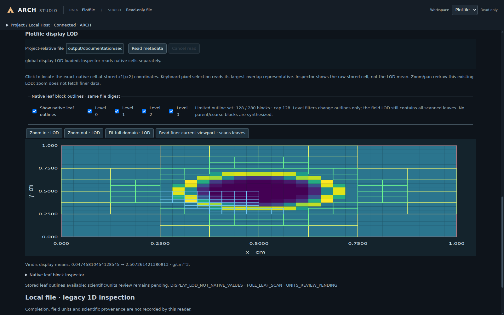

# ARCH：自适应反应流 CUDA 流体力学

[English](README.md) · [文档入口](docs/README.zh-CN.md)

[](docs/guides/Build.zh-CN.md)
[](docs/guides/Build.zh-CN.md)
[](https://github.com/Shiro-Akane/ARCH/actions/workflows/ci.yml)
[](docs/CudaBackendStatus.zh-CN.md)
[](LICENSE)

ARCH 用于模拟可压缩流体运动、热传输和核反应。程序采用有限体积方法，并通过自适应网格细化（AMR）解析不断演化的流动结构。CPU 与 CUDA 共用物理和数学实现。

**推荐使用 Linux**，包括 WSL2 中的 Linux。原生 Windows 11 x64 同样支持 CPU／CUDA 命令行程序和完整 Studio 工作流程，但可能仍有平台相关的不稳定性和缺陷。已测试配置与限制见[平台支持](docs/releases/PlatformSupport.zh-CN.md)。**科学计算不依赖 Studio。**

## 功能与文档

- 一至三维流体力学、动态 AMR，以及笛卡尔、球和柱坐标。
- 理想气体与表格状态方程、热／黏性／组分扩散、核反应、外部引力及自引力。
- CPU/OpenMP 与 CUDA 执行、HDF5 输出和兼容检查点重启。
- 用于参数编辑、初态预览、构建、运行和结果查看的桌面工作台。

[功能清单](docs/Features.zh-CN.md)说明可用组合；[参考手册](docs/Reference.zh-CN.md)提供参数与接口；[验证](validation/README.zh-CN.md)介绍参考问题、数值误差和收敛结果。

ARCH 统一使用 **CGS 单位**：长度 cm、时间 s、密度 g/cm³、压力和能量密度 erg/cm³、比内能 erg/g、温度 K、角度 rad。输入不会自动换算单位。[算例指南](docs/guides/SimulationCase.zh-CN.md#单位)说明单位与输出的解释方法。

## 构建

安装[对应平台的工具](docs/guides/Build.zh-CN.md#tools-and-dependencies)，再从仓库根目录执行以下命令。准备步骤会复用或构建同 ABI 的 HDF5；配置步骤通过共用 CMake 依赖入口提供 HighFive 和 KLU。

| 要求 | Linux／WSL2 | 原生 Windows 11 x64 |
| --- | --- | --- |
| CPU | C++20 GCC、CMake 3.22+、Ninja 和 Git | PowerShell PATH 中的 GCC/UCRT64、UCRT64 CMake/Ninja 和原生 Git |
| CUDA | CMake 3.25.2+、CUDA Toolkit 12.0+、兼容 Host 编译器和 GPU 驱动 | NVCC、MSVC 14.44 x64 Developer 终端、Kitware Windows CMake、Windows SDK 与兼容 GPU 驱动 |
| 可选 Studio | 原生 x64 Node 24+、npm 和图形会话／WSLg | 原生 x64 Node 24+、npm 和 GNU objdump |

### 获取源码

```bash
git clone --branch main --single-branch https://github.com/Shiro-Akane/ARCH.git
cd ARCH
```

已有仓库可在保存本地修改后执行 `git pull --ff-only`。

### 方案 A：CPU

Linux／WSL2：

**准备依赖**

```bash
cmake -DARCH_PROFILE=linux-core -P cmake/dependencies/Prepare.cmake
```

**配置**

```bash
cmake --preset linux-core
```

**编译**

```bash
cmake --build --preset linux-core
```

Windows PowerShell，先将 [UCRT64 工具目录加入 PATH](docs/guides/Build.zh-CN.md#windows-cpu-installation)：

**准备依赖**

```powershell
cmake -DARCH_PROFILE=windows-core -P cmake/dependencies/Prepare.cmake
```

**配置**

```powershell
cmake --preset windows-core
```

**编译**

```powershell
cmake --build --preset windows-core
```

普通源码修改后只需重复编译命令。执行物为 `build/linux-core/bin/ARCH` 和 `build/windows-core/bin/ARCH.exe`，运行方法见下一节。

### 方案 B：CPU 与 CUDA

Linux／WSL2，在 GPU 机器上执行：

**准备依赖**

```bash
cmake -DARCH_PROFILE=linux-core-with-cuda -P cmake/dependencies/Prepare.cmake
```

**配置**

```bash
cmake --preset linux-core-with-cuda
```

**编译**

```bash
cmake --build --preset linux-core-with-cuda
```

Windows，在 [MSVC 14.44 x64 Developer Command Prompt](docs/guides/Build.zh-CN.md#windows-cuda-installation) 中执行：

**准备依赖**

```bat
cmake -DARCH_PROFILE=windows-core-with-cuda -P cmake/dependencies/Prepare.cmake
```

**配置**

```bat
cmake --preset windows-core-with-cuda
```

**编译**

```bat
cmake --build --preset windows-core-with-cuda
```

这些构建在 `build/<profile>/bin/` 生成**同时具备 CPU 和 CUDA 能力的执行物**，通过参数文件的 `compute_backend = cpu`、`cuda` 或 `auto` 在运行时选择后端。cuDSS 是稀疏 CUDA 燃烧的可选依赖；普通 GPU 计算和小型 DenseLU 燃烧不依赖它。工具路径、依赖和编译内存设置见[构建指南](docs/guides/Build.zh-CN.md)。

首次 Sod 算例不需要 EOS 表。Helmholtz 算例需要真实表数据：Git 仓库可执行 `git lfs pull`，源码压缩包请按 [EOS 表数据说明](docs/guides/Build.zh-CN.md#source-archives-and-eos-tables)准备。

## 首次运行

Sod 是一个小型一维激波管。两侧不同的初始气体状态产生激波、接触面和膨胀波，适合用于首次计算。

Linux／WSL2：

```bash
export OMP_NUM_THREADS=4
./build/linux-core/bin/ARCH Sod simulation/Sod/Sod_beginner.par
```

Windows Command Prompt；CUDA 构建使用已初始化的 Developer 终端：

```bat
call build\windows-core\bin\arch-env.cmd
set OMP_NUM_THREADS=4
build\windows-core\bin\ARCH.exe Sod simulation/Sod/Sod_beginner.par
```

`arch-env.cmd` 设置配置时选定的运行库路径。使用 CUDA 构建时，将两处 `windows-core` 都换成 `windows-core-with-cuda`。

`Sod` 选择已编译的问题定义，`.par` 文件提供参数，`OMP_NUM_THREADS` 控制 CPU 工作线程数。使用 CUDA 构建时，选择相应执行物，并在输入副本中修改已有的 `compute_backend` 赋值。

程序打印时间步诊断，在 `output/first_sod/` 写入日志、场输出 Plotfile（`*_plt_*.h5`）和重启检查点（`*_chk_*.h5`）。入门输入使用 64 个单元，`simulation/Sod/Sod.par` 提供 128 单元示例。

**`.par` 内的相对路径以计算工作目录为基准，不以参数文件所在目录为基准。** `output/first_sod` 等相对路径可供两平台共用。将 Linux／WSL 参数文件用于 Windows 前，需修改其中的绝对路径；详见 [Studio 和参数文件路径](docs/guides/Studio.zh-CN.md#paths-on-linux-and-windows)。

继续阅读[模拟算例指南](docs/guides/SimulationCase.zh-CN.md)，学习查看输出、调整参数和为新问题编写 `Setup`／`Init`。

## ARCH Studio

Studio 将参数编辑、Configure/Build、初始场与初始 AMR 预览、Run/Restart 和只读 Plotfile 查看放在同一桌面工作台中。



*查看演化后的密度场、显示自适应网格，并查询实际存储的单元值。[图解 Studio 指南](docs/guides/Studio.zh-CN.md)介绍配置、预览和结果查看。*

在已经配置的 Core 构建目录中加入 Studio。安装[桌面前置依赖](docs/guides/Build.zh-CN.md#studio-desktop)后，启用选项、编译并启动：

Linux／WSL2：

**在该 Core 目录中启用 Studio**

```bash
cmake -S . -B build/linux-core -DARCH_BUILD_STUDIO=ON
```

**编译桌面**

```bash
cmake --build build/linux-core --target arch-studio --parallel 1
```

**打开空白启动页**

```bash
build/linux-core/bin/arch-studio
```

Windows PowerShell，使用构建 Core 时的同一编译器环境：

**在该 Core 目录中启用 Studio**

```powershell
cmake -S . -B build/windows-core -DARCH_BUILD_STUDIO=ON
```

**编译桌面**

```powershell
cmake --build build/windows-core --target arch-studio --parallel 1
```

**打开空白启动页**

```powershell
& .\build\windows-core\bin\arch-studio.cmd
```

已有 CUDA 构建时，将路径中的 profile 换成 `linux-core-with-cuda` 或 `windows-core-with-cuda`。Studio 共用该执行物及其 CPU／CUDA 能力，Windows 启动器自动提供工具配置。

空白启动页用于选择项目、构建目录、执行物、模型和 `.par`。直接打开模型可参考[一次性载入 Sedov 的命令](docs/guides/Studio.zh-CN.md#指定模型与参数启动)。`--config` 将参数文件载入 **Config**；**Configure** 执行 CMake 配置，**Build** 编译程序。[构建指南](docs/guides/Build.zh-CN.md#build-and-launch-the-desktop)也说明了如何给手工配置的构建目录加入 Studio。

## 扩展模型

表格 EOS 使用明确的[数据契约](src/physics/eos/TabularEOS.zh-CN.md)。[生成网络指南](src/physics/network/custom/README.md)说明如何建立和注册反应网络；[用户边界](docs/guides/UserBoundaries.zh-CN.md)介绍流体与势边界条件。

## 仓库结构

| 目录 | 内容 |
| --- | --- |
| `include/`、`simulation/` | 公共算例头文件、可运行问题和示例输入 |
| `src/` | 共用物理／数值方法、网格、driver、CPU/CUDA 执行与 I/O |
| `studio/` | 桌面窗口、本地 Host 服务和工作台 |
| `EOS_toolkit/` | EOS 表及准备工具 |
| `docs/` | 使用指南、参考和开发文档 |
| `validation/`、`tests/` | 科学参考与工程回归 |
| `tools/`、`cmake/` | 构建、验证和配置工具 |

实现职责见[源码导览](src/README.md)和[开发者指南](docs/development/README.md)。构建或数值问题可按[反馈指南](docs/guides/Reporting.zh-CN.md)整理。

## 引用

使用 v1.4.0 时，请引用 Haonan Ye、Enjie Jiang 和 Yu Ding，*ARCH: Adaptive Reactive CUDA Hydrodynamics*，版本 1.4.0，2026-10-27，[GitHub release](https://github.com/Shiro-Akane/ARCH/releases/tag/v1.4.0)。

[CITATION.cff](CITATION.cff) 提供机器可读元数据。系列 DOI 为 [10.5281/zenodo.23503924](https://doi.org/10.5281/zenodo.23503924)，v1.3.0 的版本 DOI 为 [10.5281/zenodo.23503925](https://doi.org/10.5281/zenodo.23503925)。v1.4.0 尚未发布对应的 Zenodo 版本。请引用实际计算所用版本，详见[引用指南](docs/zenodo/README.md)。

## 许可

ARCH 自有代码采用 [MIT 许可](LICENSE)。第三方科学代码和数据保留各自条款，见[第三方说明](THIRD_PARTY_NOTICES.zh-CN.md)和[许可目录](LICENSES)。
