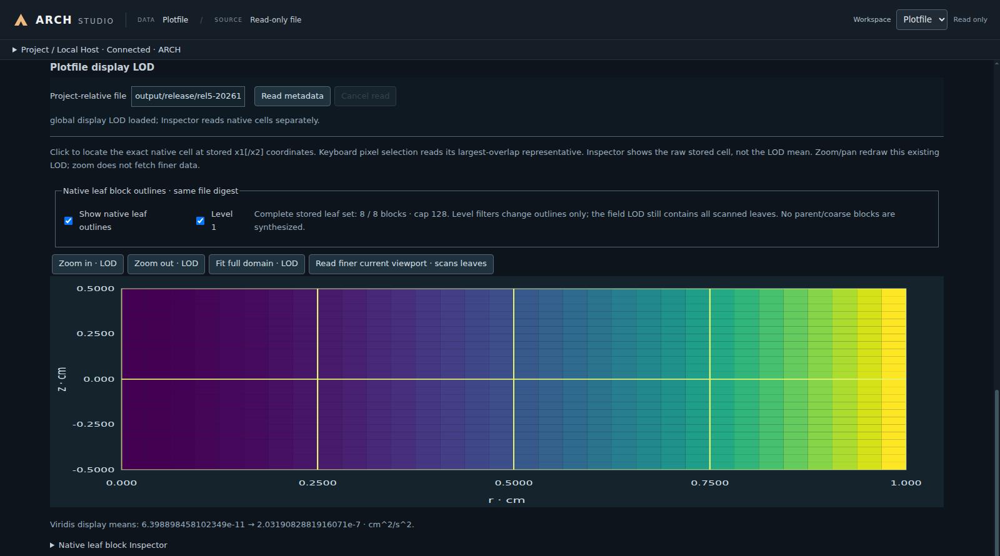

# ARCH Studio: configure, preview, run and inspect output

[中文](Studio.zh-CN.md) · [Homepage](../../README.md) · [Environment](StudioEnvironment.md)

Studio is optional; Core runs independently. **Linux/WSL2 is recommended. Native Windows 11 x64 provides the complete CPU Studio workflow, but its newer support may still have instability or bugs.** The systems share configuration, scientific Preview and Plotfile services. Native Windows CUDA/MPI are outside this qualification; use Linux for the established CUDA route.

## Build and launch: Linux, then Windows

Prepare Core using the [build guide](Build.md), then native Node24+, Electron and the terminal prerequisites in the [environment guide](StudioEnvironment.md). Start from the ARCH root.

Linux/WSL2:

```bash
cmake --preset studio-cpu-release -DARCH_STUDIO_NODE=/absolute/path/to/node
cmake --build build-studio-cpu --parallel 2
build-studio-cpu/bin/arch-studio --project "$PWD" --build-dir build-studio-cpu \
  --binary build-studio-cpu/bin/ARCH --case Sod --config simulation/Sod/Sod_beginner.par
```

Native Windows: complete the [GCC/UCRT64 Core setup](WindowsNativeCpu.md), then enable Studio and configure the trusted tools/DLL context in the [desktop build guide](WindowsStudioDesktop.md). In PowerShell:

```powershell
& .\build-studio-cpu\bin\arch-studio.cmd --project "$PWD" --build-dir build-studio-cpu `
  --binary build-studio-cpu/bin/ARCH.exe --case Sod --config simulation/Sod/Sod_beginner.par
```

Use the actual configured build directory; `--build-dir` explicitly adopts an existing tree. A checkout launcher depends on that checkout. Keep portable package directories intact: start `arch-studio` on Linux or `arch-studio-bin.exe` on Windows. Host Node and h5wasm are bundled; Core, system dependencies and the Run terminal remain external. Connections are managed internally: no Vite server or port entry is needed.

## Workspaces

Check **MODEL / PARAMETERS** at the top, then use **Workspace** at the top right to select **Config** or **Plotfile**. Config places parameters on the left and **Real initial condition** in the center; selecting a parameter opens its **Parameter Inspector** on the right. Expand **Project / Local Host** above the workspace to inspect project, source, executable and build state. Run/Restart actions are in the lower workflow area.



*This shows recorded output, separate from the initial-state Preview.*

## Config: select a model and parameter file

1. **Select the project and compiled model first.** The startup page accepts Project, Existing build directory, Binary, Registered model and Source, or use the launch commands above. After connection, choose a registered case such as Sod using **Real initial condition → Model**. **Retry model discovery** retries a failed discovery against the current binary.
2. **Source and parameters are separate.** `--source simulation/Sod/Sod.cpp` or the startup Source field binds a registered compiled source; it does not import and compile arbitrary C++. A selected source fixes the model. Pending source identity, incomplete discovery or a busy workflow can disable the selector. Reopen the project with another source to change that binding. Add/register and compile a new case using the [case guide](SimulationCase.md); selecting a source cannot update an old executable.
3. **Open the `.par` next.** Use **Config file → Open Parameter File (.par)…** on the left, or **Load Project Parameter File** for the associated project input. Start with `simulation/Sod/Sod_beginner.par`. Check the top model/file labels and **Source & parameter association**; filenames do not establish compatibility.

## Config: inspect, edit and save

Work from left to right. Expand parameter groups such as Grid, EOS, Network, Gravity, Diffusion and Runtime. Search by name, raw key or description. Additional controls appear in **Advanced** or **Inactive settings**; hidden fields can still contain errors.

Each **Help** entry gives the raw key, type, unit, permitted values, applicability and whether a default is allowed. Select a parameter to compare Working Copy, Saved value, parsed values and diagnostics in **Parameter Inspector**. Missing metadata remains Unavailable. Full definitions are in the [reference](../Reference.md). Core uses CGS: for example cm, g/cm³, erg/cm³, K and rad.

Edit an input, select or toggle to change the **Working Copy**. Correct **View issues**, inline errors and path checks, then use **Generate Real Preview / Update Preview** in the center. Preview may use unsaved input, provided model/build identity, configuration and sampling gates pass. It calls real Setup/Init; **Initial AMR** is a separate bounded request, not time evolution. Field/coordinate/color scales and ranges affect display only; log cannot turn zero or negative stored values positive.

- **Save** writes the associated file. **Save Working Copy As…** saves a new in-project `.par`; use a copy for a first experiment. External disk changes retain the Working Copy for reload or Save As.
- **Download Copy…** exports a download; it does not establish a saved project association for Run.
- After C++ edits, explicitly **Configure / Build** in **Project / Local Host** and inspect output/identity checks. Refreshing is not compilation. Incomplete dependency evidence stays unknown.
- In the lower workflow area, prepare **Run / Restart**, inspect the saved input, binary, output directory and checkpoint, then confirm. Confirmed jobs run in an independent terminal and can survive desktop exit. Stop targets the recorded job.

## Plotfile: load and inspect results

Choose **Workspace → Plotfile**; the page heading is **Real Plotfile**. Prefer the upper **Project Plotfile Viewer · read-only**:

1. Enter a **Project-relative file**, for example `output/first_sod/SodBeginner_HLLC_plt_0000.h5`, and click **Read metadata**. Choose an actual `_plt_` field output, not a `_chk_` restart file; use the name/index on disk.
2. Check Time, Geometry / dimension, Stored shape, completion and provenance before selecting a **Stored field** such as DENS or PRES.
3. Choose **Block index, Start, Count → Read raw samples** for stored values. The table and supported curve/native view appear below; use the row's **Inspect** button for that cell's coordinates and units.
4. Use **Read global display LOD · scans leaves** for an overview. It requires native grid evidence and currently covers Cartesian1D/2D and cylindrical r-z2D. Bounded cell queries in other geometries/dimensions do not imply 3D rendering. Use Fit, zoom or drag to navigate. LOD is display downsampling; obtain exact stored values from raw samples/Inspector.

The lower **Local file · legacy 1D inspection → Open Plotfile…** is a separate older browser reader without formal completion/provenance verification. Keep it distinct from project-scoped reads. The complete `.h5` remains authoritative, and all views are read-only. Initial Preview, evolved output and scientific numerical qualification are separate results.

## Paths on Linux and Windows

Distinguish **OS paths** from **Studio project-relative paths**.

| Location | Linux / WSL2 | Native Windows |
| --- | --- | --- |
| Project/tools | `/home/user/ARCH`, `/usr/bin/cmake` | `C:/work/ARCH`, `C:\tools\cmake.exe` |
| Core | `build-studio-cpu/bin/ARCH` | `build-studio-cpu/bin/ARCH.exe` |
| Studio config/Plotfile/Save As relative inputs | Both systems use forward-slash paths such as `simulation/Sod/Sod_beginner.par` or `output/first_sod/xxx.h5` | Do not enter a drive prefix, `/mnt/c` or `..` here; native dialogs convert in-project selections |
| `.par` output/restart/table values | Relative to the calculation working directory, or actual Linux absolute paths | Same relative rule; adapt absolute paths to Windows, preferably `C:/work/ARCH/...` |

Studio starts Core in the project root; a CLI run uses the terminal's current directory. Thus `out_dir = output/first_sod` is usually portable and **does not mean beside the `.par`**. After copying a Linux `.par` to Windows, inspect `out_dir`, `restart_file` and EOS/network table paths individually. Changing separators alone does not translate namespaces; provide actual values without relying on shell variable expansion.

WSL `/mnt/c/work/ARCH` and Windows `C:/work/ARCH` may name the same disk location, but `/home/...` and `/mnt/c/...` are not native Windows Core paths. Windows paths likewise cannot be passed directly to Linux Core. Quote shell arguments containing spaces. Keep `.par` UTF-8 and preserve its syntax rather than copying Bash escapes or PowerShell quotes/backticks into values. Never share CMake caches, Node executables or ABI dependencies between systems. UNC/network filesystems and arbitrary long paths were not qualified by local NTFS checks.

Further reading: [build](Build.md), [environment](StudioEnvironment.md), [feature scope](../Features.md), [scientific validation](../../validation/README.md), and [Host tests](../../studio/tests/README.md). Platform adaptation does not relax equations, scientific formats or established error budgets.
