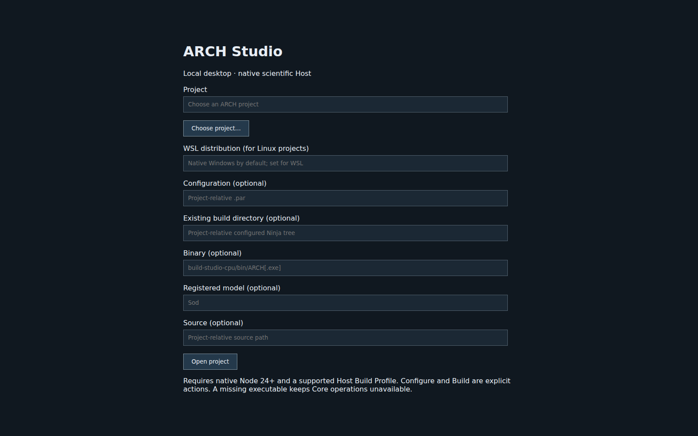
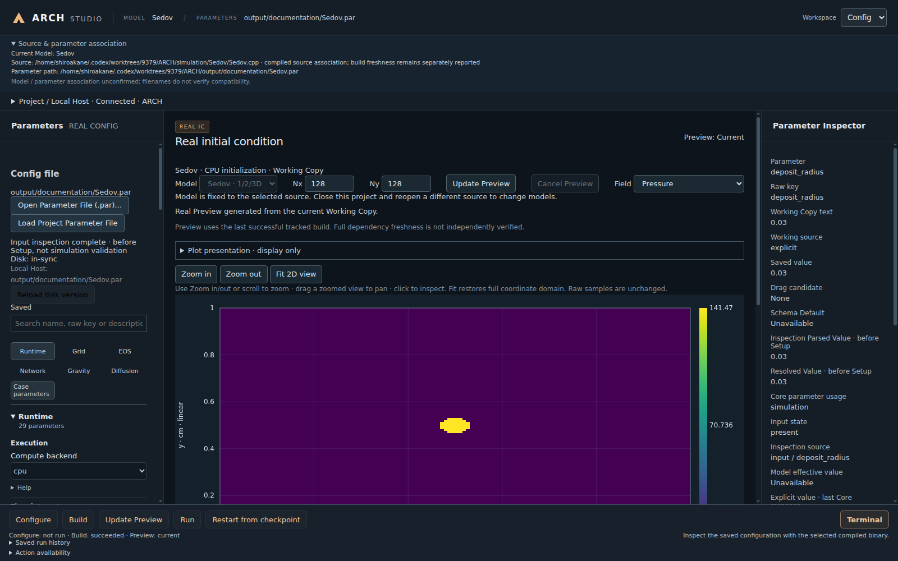
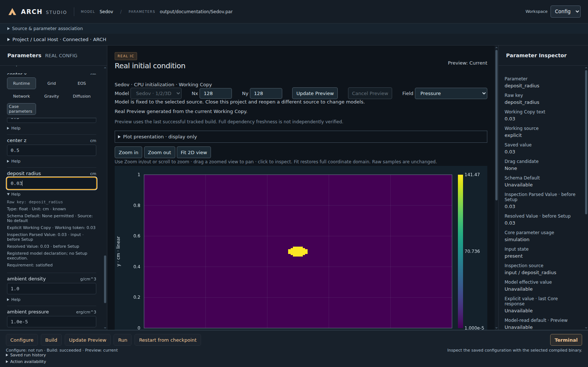
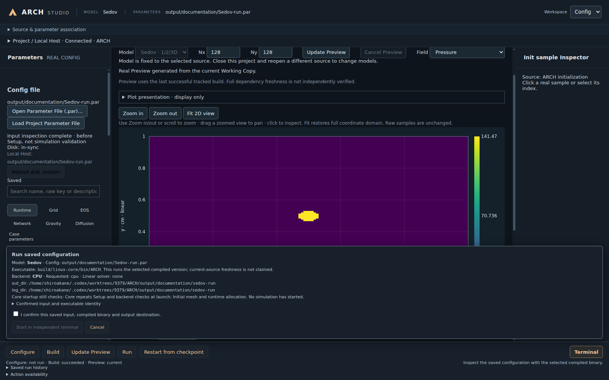
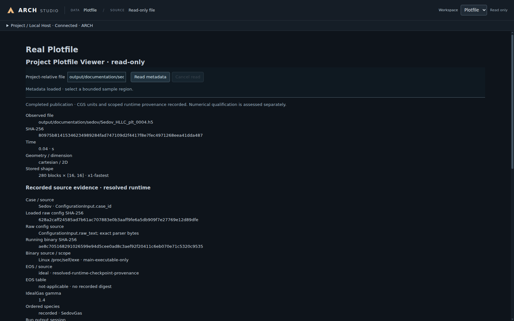
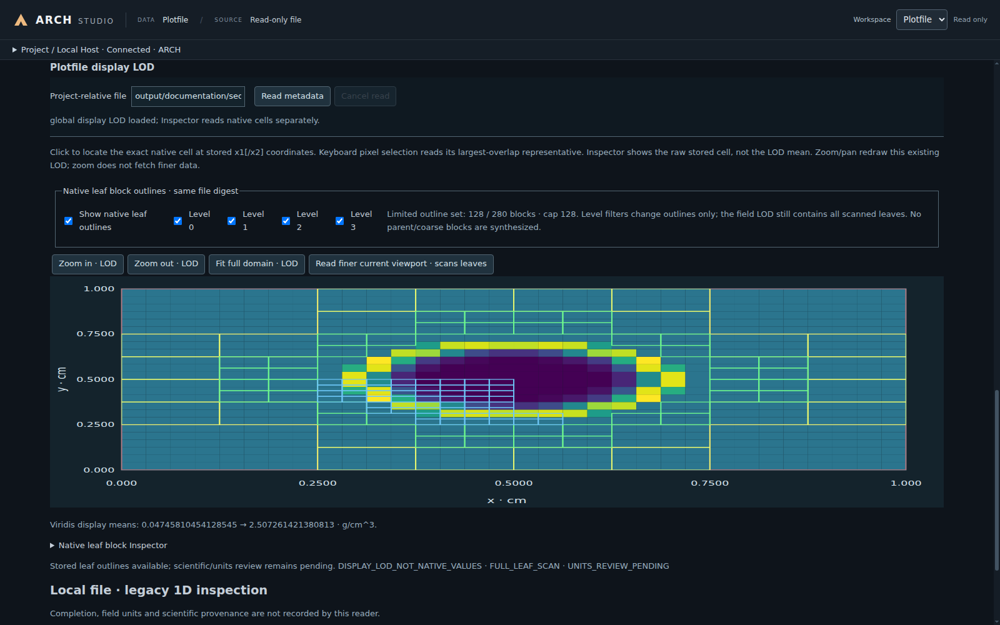

# ARCH Studio

[中文](Studio.zh-CN.md) · [Build and installation](Build.md) · [Parameter reference](../Reference.md)

Studio is a desktop workbench for preparing a calculation, previewing its initial state, running it and inspecting HDF5 output. Linux and Windows use the same workspaces. Linux is recommended for scientific runs; native Windows 11 supports the corresponding CPU/CUDA workflow, with newer platform support that may still have bugs. See [platform requirements](../releases/PlatformSupport.md).

## Open a project

Install the optional desktop using the [build guide](Build.md). These examples use the `linux-core` / `windows-core` tree with Studio enabled; substitute your actual build directory if different. From the project root, run the launcher without arguments to open the empty start page:

Linux / WSL2:

```bash
build/linux-core/bin/arch-studio
```

Windows PowerShell; the generated launcher loads its local tool configuration automatically:

```powershell
& .\build\windows-core\bin\arch-studio.cmd
```



No project, model or `.par` is loaded yet. Click **Choose project…** to select an ARCH project, then enter the build directory, Core executable, model and parameter file. Click **Open project** to enter the workbench.

### Launch with a model and parameter file

You can also select the project, build, model and parameter file in one command. These examples open Sedov with a configured CPU build:

Linux / WSL2:

```bash
build/linux-core/bin/arch-studio --project "$PWD" --build-dir build/linux-core \
  --binary build/linux-core/bin/ARCH --case Sedov \
  --source simulation/Sedov/Sedov.cpp --config simulation/Sedov/Sedov.par
```

Windows PowerShell:

```powershell
& .\build\windows-core\bin\arch-studio.cmd --project "$PWD" --build-dir build/windows-core `
  --binary build/windows-core/bin/ARCH.exe --case Sedov `
  --source simulation/Sedov/Sedov.cpp --config simulation/Sedov/Sedov.par
```

`--config` loads the selected `.par` into the **Config** workspace for editing. The launch options above mean:

| Option | Purpose |
| --- | --- |
| `--project` | ARCH project root |
| `--build-dir` / `--binary` | Existing CMake build directory and its Core executable |
| `--case` | Model registered in that executable, here `Sedov` |
| `--source` | Model source to bind and check against the compiled registration |
| `--config` | Parameter file to open, here `simulation/Sedov/Sedov.par` |

Relative file and build paths resolve from `--project` (the current directory when omitted); the parameter file must be inside the project. The **Configure** button runs CMake configuration, and **Build** compiles the program.

On launch, Config shows the Sedov model and its parameters. When the input and build are ready, Studio generates the initial preview; **Preview** also updates it manually. Select **Field → Pressure** for the initial central spot shown below. Save and confirm **Run** to evolve the model, then open a generated Plotfile for the expanded density field shown later.

Use the build directory and executable you actually compiled. For CUDA, select that CUDA build instead. A portable desktop package starts with `arch-studio` on Linux or `arch-studio-bin.exe` on Windows; its project screen accepts the same project, build, binary, model and parameter selections. Keep the package directory intact. The scientific Core and its runtime libraries are installed separately. For a portable Windows package, select its trusted local [tool configuration](Build.md#windows-tool-configuration).

## Workspaces



Read the window from left to right:

1. **MODEL / PARAMETERS** names the selected model and file. Expand **Source & parameter association** to check their paths.
2. The left **Parameters** panel contains the working copy. **Config file** opens or reloads a `.par`.
3. The center **Real initial condition** panel previews the model. The right **Inspector** explains the selected parameter or sample.
4. **Project / Local Host** shows the selected executable and build. The bottom bar provides Configure, Build, Preview, Run and Restart.
5. **Workspace**, at the upper right, switches between **Config** and **Plotfile**.

The illustrations use the supplied two-dimensional Sedov case. The small central spot above is its initial pressure deposition; the expanded blast wave appears in the output view below.

## Select a model and parameter file

Choose a registered model from **Real initial condition → Model**, then use **Open Parameter File (.par)…** or **Load Project Parameter File**. For a first run, use Sod and `simulation/Sod/Sod_beginner.par`.

The model list comes from the selected Core executable. An explicit Source selection, such as `simulation/Sedov/Sedov.cpp`, binds the project to that model. To select another source, close and reopen the project. To add your own model, follow the [case guide](SimulationCase.md), register its inputs and compile it before selecting it in Studio.

## Inspect and adjust parameters



Use the parameter groups or search box to find a setting. **Help** shows its raw `.par` key, type, unit and allowed values. Focusing an input opens **Parameter Inspector**: compare the Working Copy, Saved value and parsed value there. In the illustration, `deposit_radius = 0.03` is a length in cm. Full definitions are in the [reference](../Reference.md).

Edit a text field, select an option or toggle a switch. Review inline errors and **View issues** before continuing. Advanced and inactive settings are grouped separately. ARCH uses CGS units, including cm, g/cm³, erg/cm³ and K.

- **Save** updates the associated file.
- **Save Working Copy As…** writes a new `.par` inside the project and associates it with the workbench. This is useful for experiments that should preserve the original input.
- **Download Copy…** exports a copy; use the project save actions for the input you intend to run.
- If the file changes outside Studio, reload the disk version or save the working copy under a new name.

For GPU execution, select `compute_backend = cuda` in Runtime and save, using a CUDA-enabled binary. `cpu` requests CPU execution; `auto` lets Run preparation select a supported route. Review the requested and selected backends and the selection reason before confirming. The Run log and `*_backend_plan.txt` record the route used.

## Preview and run

**Generate Real Preview / Update Preview** evaluates the model's initial state using the current working copy, including unsaved parameter edits. Choose a **Field**, then use Fit, zoom or drag to inspect it. Plot presentation controls change axes, colors and display ranges. **Initial AMR** constructs an initial refinement hierarchy with its own block and memory limits. Preview uses CPU initialization; time evolution starts with Run.

After editing C++, use **Configure / Build** so that the executable includes the change. The build panel reports progress and input freshness. If it shows `freshness-unknown`, open its diagnostics to see which dependency could not be verified.



Save the input, choose **Run**, and review the model, executable, output directory and proposed command before confirming. **Restart from checkpoint** uses the saved restart settings and selected checkpoint. A confirmed calculation runs in an independent terminal and can continue after the desktop closes. Use the recorded run's **Stop** action to stop it.

## Load a Plotfile

Choose **Workspace → Plotfile** and use **Project Plotfile Viewer · read-only**.



1. Enter a **Project-relative file**, such as `output/sedov_standard/Sedov_HLLC_plt_0001.h5`, and click **Read metadata**. Use an actual `_plt_` output from your run; `_chk_` files are restart checkpoints.
2. Check the physical time, geometry, dimensions and completion status. Select **Stored field**, for example `DENS` or `PRES`.
3. For exact stored values, choose **Block index**, **Start** and **Count**, then **Read raw samples**. Use **Inspect** beside a sample to see its coordinates and units.
4. For a full-domain image, choose **Read global display LOD · scans leaves**. Fit and zoom locate features; leaf outlines show AMR blocks. The overview uses display downsampling. The cell Inspector reads the corresponding stored cell.



This two-dimensional overview uses a 32 × 24 display grid. The outline overlay shows 128 of the 280 leaf blocks.

Image overviews support Cartesian 1D/2D and cylindrical r-z 2D. Other supported geometries and dimensions offer bounded cell queries. The lower **Local file · legacy 1D inspection** opens a standalone file; use the project viewer for completion and provenance information.

## Paths on Linux and Windows

| Where the path is used | What to enter |
| --- | --- |
| Project, compiler or executable location | A path native to the running OS: `/home/user/ARCH` on Linux, `C:/work/ARCH` on Windows |
| Studio config, Plotfile or Save As field | A project-relative path using `/`, such as `simulation/Sod/Sod_beginner.par` |
| `.par` output, restart or table setting | A path relative to the calculation's working directory, or an absolute path for that OS |

Studio runs Core from the project root. A CLI run uses the terminal's current directory. Thus `out_dir = output/first_sod` is relative to that working directory, **not to the directory containing the `.par` file**.

When moving a Linux `.par` to Windows, check `out_dir`, `restart_file` and EOS/network table paths. `/mnt/c/work/ARCH` is a WSL path; native Windows uses `C:/work/ARCH`. Changing separators alone does not translate the path. Project-relative paths are the easiest way to share inputs.

Keep parameter files in UTF-8; LF and CRLF are accepted. Write path values using `.par` syntax, without copying shell quoting or relying on shell variable expansion. Quote command-line arguments that contain spaces. Use separate build directories, CMake caches and ABI dependencies for each OS/toolchain.
