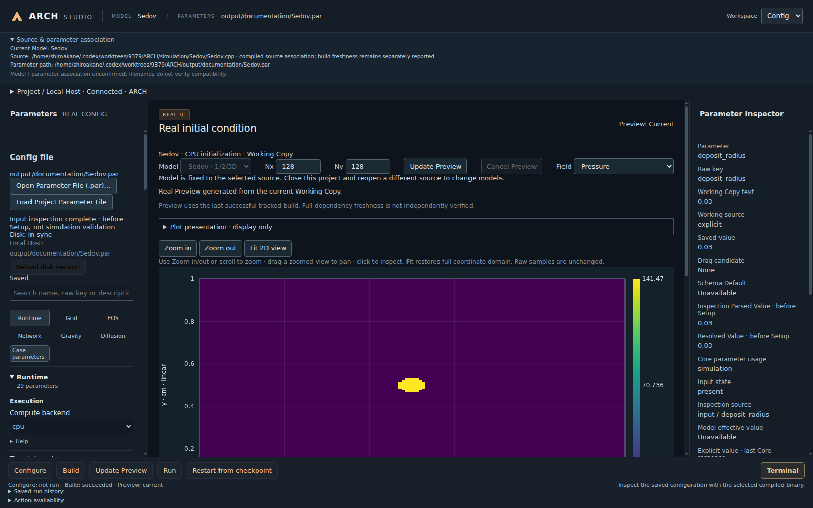
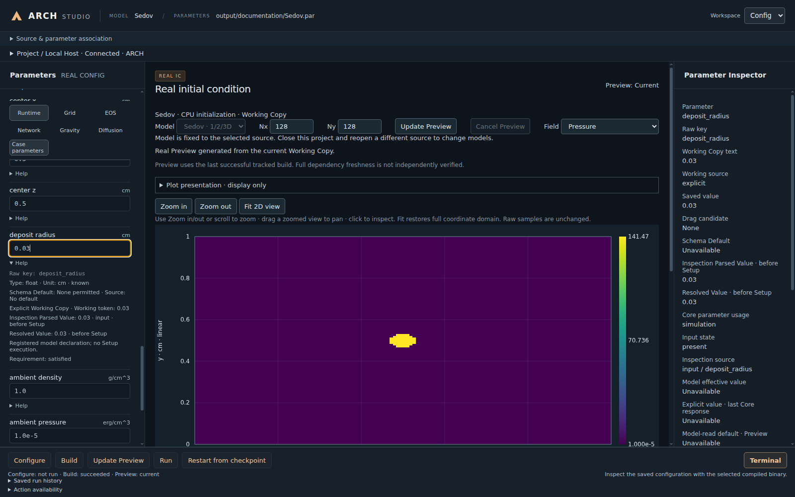
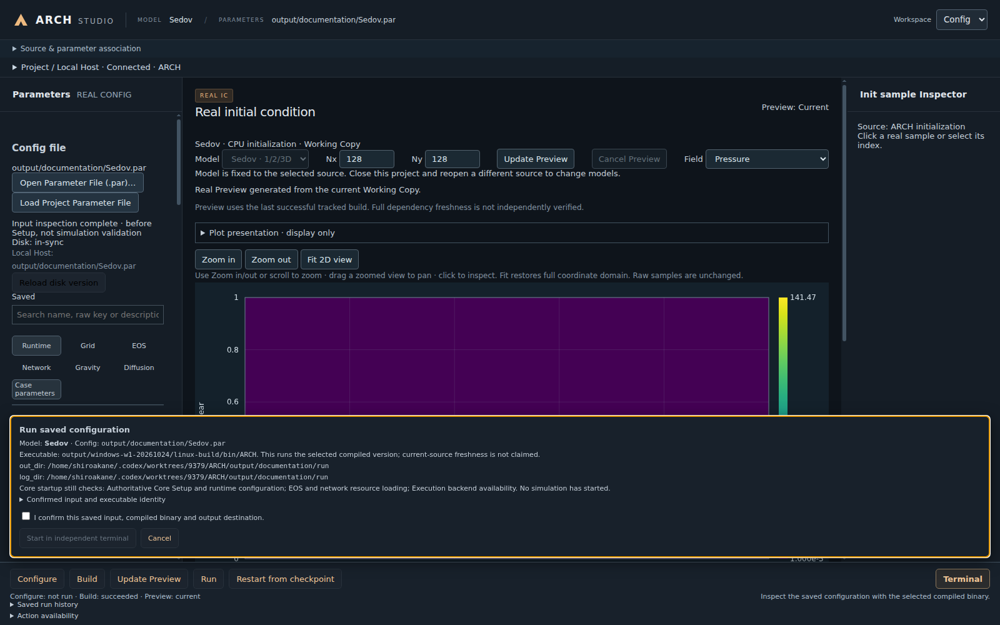
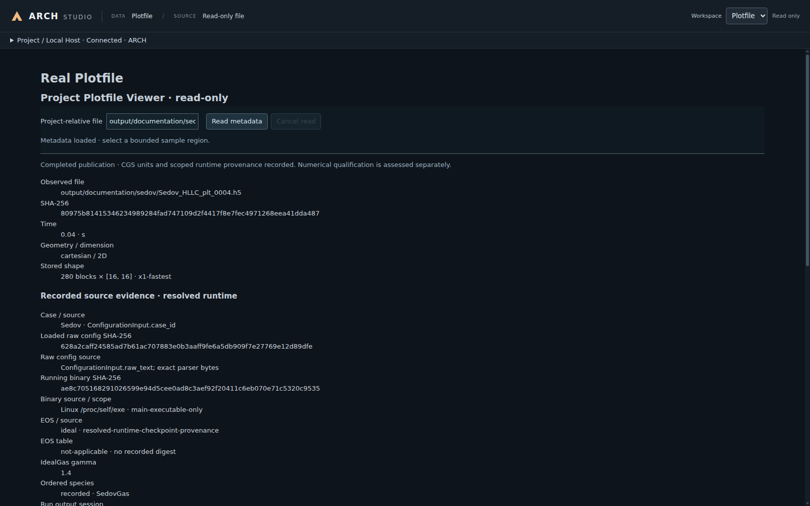
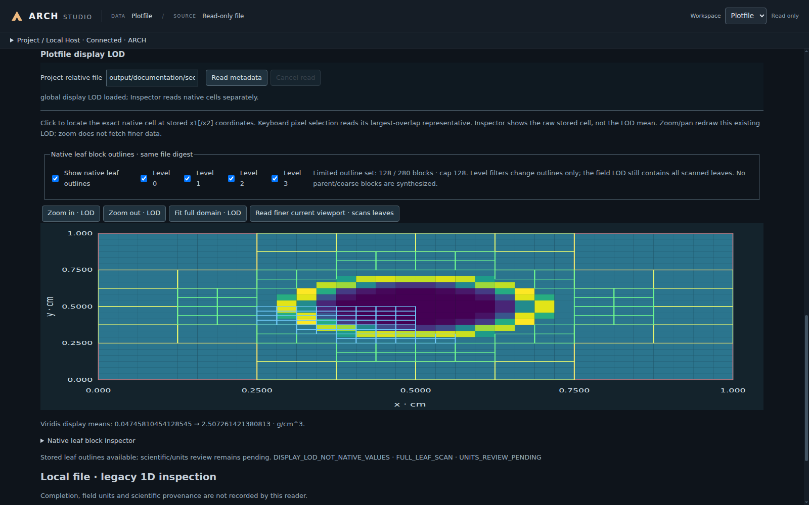

# ARCH Studio

[English](Studio.md) · [构建与安装](Build.zh-CN.md) · [参数参考](../Reference.zh-CN.md)

Studio 是用于准备计算、预览初始状态、运行算例和查看 HDF5 输出的桌面工作台。Linux 与 Windows 使用相同的界面。推荐使用 Linux 进行科学计算；原生 Windows 11 提供对应的 CPU／CUDA 工作流，但适配较新，可能仍有平台相关 bug。具体要求见[平台支持](../releases/PlatformSupport.zh-CN.md)。

## 打开项目

按[构建指南](Build.zh-CN.md)安装可选桌面组件。从项目根目录启动已配置的 CPU 构建：

Linux／WSL2：

```bash
build-studio-cpu/bin/arch-studio --project "$PWD" --build-dir build-studio-cpu \
  --binary build-studio-cpu/bin/ARCH --case Sod --config simulation/Sod/Sod_beginner.par
```

Windows PowerShell：

```powershell
& .\build-windows-cpu\bin\arch-studio.cmd --project "$PWD" --build-dir build-windows-cpu `
  --binary build-windows-cpu/bin/ARCH.exe --case Sod --config simulation/Sod/Sod_beginner.par
```

填写实际使用的构建目录与可执行文件；使用 CUDA 时选择对应的 CUDA 构建。便携桌面包在 Linux 下运行 `arch-studio`，在 Windows 下运行 `arch-studio-bin.exe`，启动页可填写相同的项目、构建、程序、模型和参数选项。保留整个包目录，科学计算 Core 及其运行库另行安装。

<a id="workspaces"></a>
## 界面导航



按从左到右的顺序查看界面：

1. 顶部 **MODEL / PARAMETERS** 显示模型与参数文件。展开 **Source & parameter association** 可查看路径。
2. 左侧 **Parameters** 是参数工作副本，**Config file** 用于打开或重新加载 `.par`。
3. 中间 **Real initial condition** 显示初始状态，右侧 **Inspector** 解释当前参数或采样点。
4. **Project / Local Host** 显示选定程序与构建；底部提供 Configure、Build、Preview、Run 和 Restart。
5. 右上角 **Workspace** 在 **Config** 与 **Plotfile** 之间切换。

图中使用项目自带的二维 Sedov 算例。中心亮点是初始压力沉积区域；时间推进后的爆炸波见后面的输出图。

## 选择模型与参数文件

在 **Real initial condition → Model** 选择已注册模型，再用 **Open Parameter File (.par)…** 或 **Load Project Parameter File** 加载参数。首次使用可选择 Sod 和 `simulation/Sod/Sod_beginner.par`。

模型列表来自选定的 Core 可执行文件。显式指定 Source，例如 `simulation/Sedov/Sedov.cpp`，会把项目绑定到该模型；更换源码时关闭并重新打开项目。添加自己的模型时，先按[算例指南](SimulationCase.zh-CN.md)注册输入并编译，再到 Studio 中选择。

## 查看与调整参数



通过参数分组或搜索框找到设置。**Help** 显示 `.par` 原始键、类型、单位和允许值；点击输入框后，右侧 **Parameter Inspector** 可对照 Working Copy、Saved value 和解析值。图中的 `deposit_radius = 0.03` 表示 0.03 cm。完整定义见[参数参考](../Reference.zh-CN.md)。

直接编辑文本框、选择选项或调整开关。继续操作前检查行内提示和 **View issues**。高级项和非活动项单独分组。ARCH 使用 CGS 单位，例如 cm、g/cm³、erg/cm³ 和 K。

- **Save** 更新已关联文件。
- **Save Working Copy As…** 在项目内保存新的 `.par`，并将它关联到工作台；适合保留原始输入的对照实验。
- **Download Copy…** 导出一个副本。用于实际运行的输入请通过项目保存动作关联。
- 文件被外部程序修改时，可重新加载磁盘版本，或将工作副本另存为新文件。

使用 GPU 时，在 Runtime 中选择 `compute_backend = cuda`，保存后用包含 CUDA 的程序开始新的 Run。`cpu` 指定 CPU，`auto` 在启动时选择可用后端。实际选择见运行日志和 `*_backend_plan.txt`。

## 预览与运行

**Generate Real Preview / Update Preview** 使用当前工作副本计算模型初始状态，也可预览尚未保存的参数修改。选择 **Field**，再用 Fit、缩放或拖动查看。Plot presentation 调整坐标、配色和显示范围。**Initial AMR** 使用独立的块数与内存预算生成初始细化层级。Preview 采用 CPU 初始化；Run 开始时间推进。

修改 C++ 后使用 **Configure / Build**，让程序包含源码变化。构建面板显示进度和输入状态。当完整依赖链无法核实时，构建成功后仍可能显示 `freshness-unknown`；操作区会说明哪些动作可用。



保存输入后选择 **Run**，核对模型、程序、输出目录和拟执行命令，再确认启动。**Restart from checkpoint** 使用已保存的重启参数与选定 checkpoint。确认后的计算在独立终端运行，关闭 Studio 后也可继续；使用对应运行记录的 **Stop** 停止它。

## 读取 Plotfile

选择 **Workspace → Plotfile**，使用 **Project Plotfile Viewer · read-only**。



1. 在 **Project-relative file** 输入项目相对路径，例如 `output/sedov_standard/Sedov_HLLC_plt_0001.h5`，点击 **Read metadata**。选择实际运行产生的 `_plt_` 文件；`_chk_` 是重启检查点。
2. 核对物理时间、几何、维数与完成状态，再选择 **Stored field**，例如 `DENS` 或 `PRES`。
3. 要查看精确存储值，设置 **Block index、Start、Count**，点击 **Read raw samples**。采样行旁的 **Inspect** 显示单元坐标与单位。
4. 要看全域图像，点击 **Read global display LOD · scans leaves**。用 Fit 与缩放定位结构，叶块轮廓显示 AMR 网格。总览采用显示降采样，单元 Inspector 读取对应的原始存储值。



图中的二维总览采用 32 × 24 显示采样；叶块轮廓显示 280 块中的 128 块。

图像总览支持笛卡尔 1D／2D 和柱坐标 r-z 2D，其他受支持几何与维数可通过有界单元查询查看数据。下方 **Local file · legacy 1D inspection** 用于打开独立文件；需要完成状态与来源信息时使用项目查看器。

<a id="paths-on-linux-and-windows"></a>
## Linux 与 Windows 的路径

| 路径使用位置 | 填写方式 |
| --- | --- |
| 项目、编译器或程序位置 | 当前系统的原生路径：Linux 如 `/home/user/ARCH`，Windows 如 `C:/work/ARCH` |
| Studio 的 config、Plotfile 或 Save As 字段 | 使用 `/` 的项目相对路径，如 `simulation/Sod/Sod_beginner.par` |
| `.par` 中的输出、重启或表文件设置 | 相对计算工作目录的路径，或当前系统的绝对路径 |

Studio 从项目根目录运行 Core；CLI 使用终端当前目录。因此 `out_dir = output/first_sod` 相对该工作目录，**不是相对 `.par` 文件所在目录**。

将 Linux `.par` 移到 Windows 时，检查 `out_dir`、`restart_file` 和 EOS／网络表路径。`/mnt/c/work/ARCH` 属于 WSL，原生 Windows 使用 `C:/work/ARCH`。只替换分隔符不能完成路径转换；项目相对路径最便于共享输入。

参数文件使用 UTF-8，支持 LF 与 CRLF。路径值遵循 `.par` 语法，不照抄 shell 引号，也不依赖 shell 变量展开。命令行中的含空格参数需要引用。不同系统或编译器 ABI 使用各自的构建目录、CMake 缓存与依赖库。
