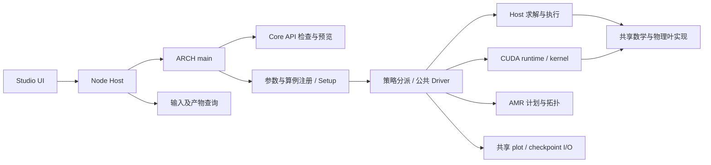

# 现代化 R1：仓库结构与模块归属映射

> 已完成阶段的历史快照；状态和下一工作包以[现代化主计划](../../../ARCH_MODERNIZATION_PLAN.md)为准。归档仅调整阅读位置与相对链接，原调查／验收身份保留。

R1 已完成结构映射；阶段 1 的深层调用与实现检查仍未完成，R2 未启动。本页是[现代化总计划](../../../ARCH_MODERNIZATION_PLAN.md)的证据跳板，不替代[既有实现所有权表](../../development/ImplementationOwnership.md)或数值契约。本页的 R1 是现代化工作包，与旧优化计划的 release R1–R6 编号不同。

## 范围与基线

| 项目 | 已核实结果 |
|---|---|
| 检查基线 | `compute/optim`，`a0185bdf524d374f9c804666a98a4c76668db044`；开始时与 `origin/compute/optim` 一致，工作区干净 |
| 工作入口 | [AGENTS.md](../../../AGENTS.md) → [总计划](../../../ARCH_MODERNIZATION_PLAN.md) → [前置记录](Preflight-20261012.zh-CN.md)；项目 `arch-engineering` 与全局 `multimodel-engineering` |
| 实际目录 | `/home/shiroakane/.codex/worktrees/d7a6/ARCH`；主目录 `/home/shiroakane/ARCH` 脱离分支停在 `9aaa5addd…`，保留旧执行物；共两个 worktree |
| 路径与环境 | 沿用 AGENTS 中已验证的 WSL 读取入口；科学 Python 使用 `work`，本轮分类脚本使用该环境的 Python；未修改全局环境 |
| 检查方式 | Git 全路径清点、目录与入口检查、代表源码／CMake／契约阅读、两个 DeepSeek 只读调查及 Codex 独立核对 |
| 覆盖含义 | 11,076 条基线路径均为常规文件，无 gitlink／子模块；全部分类为 115 个互斥分组，未分类 0；**不等于逐文件阅读、完整调用图或科学验收** |
| 本轮执行边界 | 只更新文档及覆盖索引；未 configure、编译、运行科学测试或原生 GUI；未重跑 RZ、CUDA 长程，也未做性能优化 |

完整分类见[覆盖索引 JSON](../../development/archive/modernization/ModernizationR1-RepositoryCoverage-20261012.json)。索引按目录最长前缀分组，细分单文件用精确匹配；每个路径仅计入一组。计数对应上述旧基线，不包含 R1 新建文档。

## 全仓分布

以下数量是版本化路径数，包含相应目录中的说明、输入和证据，并非实现文件数。

| 区域 | 路径数 | 主要归属与边界 | 检查入口 |
|---|---:|---|---|
| 根文件 | 12 | 项目入口、战略计划、CMake／presets、许可与 Git 规则 | [README](../../../README.zh-CN.md)、[CMakeLists](../../../CMakeLists.txt) |
| `.agents`／`.github` | 2／4 | 项目 Skill、CI、安全配置、默认 reviewer；CODEOWNERS 不等于数学 owner | [Skill](../../../.agents/skills/arch-engineering/SKILL.md)、[CI](../../../.github/workflows/ci.yml) |
| `src` | 579 | 科学核心、运行时、API、后端及局部文档；`src` 内 428 个 `.h/.cpp/.inc/.cuh/.cu/.hpp` 路径 | 下表及 [src 导航](../../../src/README.md) |
| `include` | 3 | ARCH 自有的算例公共转发头与说明；不是第三方 SDK | [include](../../../include/README.md) |
| `simulation` | 59 | 16 个算例目录，20 个 `.cpp`；Setup／Init、注册、边界辅助及 `.par` 输入；实际算法在公共核心 | [算例目录](../../../simulation/README.md) |
| `cmake` | 23 | 目标归属、依赖、生成注册、CUDA 路由、测试与 Studio 构建 | [cmake 导航](../../../cmake/README.md) |
| `studio` | 337 | UI／数据适配、Node Host、Electron、测试、契约和归档 | [Studio](../../../studio/README.md) |
| `tests` | 225 | Host／CUDA／数学／API／工具契约、夹具与冒烟 | [测试入口](../../../tests/README.md)、[注册说明](../../../cmake/tests/README.md) |
| `tools`／`examples` | 23／3 | 验证、资源护栏、身份与架构检查、网络生成适配；开发者示例 | [工具](../../../tools/README.md)、[示例](../../../examples/README.md) |
| `validation` | 9,165 | 独立参考、runner、输入、版本化证据及历史实验；其中 `results` 路径 8,875 条 | [验证入口](../../../validation/README.zh-CN.md) |
| `docs` | 628 | 当前指南／科学契约、开发记录、发布材料与历史归档；development 占 589 条 | [文档导航](../../README.md)、[开发入口](../../development/README.md) |
| `EOS_toolkit`／`LICENSES` | 9／4 | 外部 EOS 表、格式／来源说明和许可证；读取与物理模型在 `src/physics/eos` | [EOS 表](../../../EOS_toolkit/README.md)、[来源声明](../../../THIRD_PARTY_NOTICES.md) |

## 科学核心与应用分层

| 模块 | 路径数 | 功能与主要归属 | 代表入口／消费者 |
|---|---:|---|---|
| `src/main.cpp`、`src/README.md` | 2 | CLI 入口先识别 API 命令；常规运行再加载参数、创建算例、Setup、解析边界并分派 | [main.cpp](../../../src/main.cpp) |
| `src/core`／`data` | 34／7 | 配置、注册、可移植标注、文件身份；状态／配置记录、诊断与单位 | [ProblemRegistry](../../../src/core/problem/ProblemRegistry.h)、[GlobalDefs](../../../src/data/GlobalDefs.h) |
| `src/grid`／`interface` | 7／4 | 网格布局、几何度量／视图、标量场；算例接口与初始生成契约 | [GridMetrics](../../../src/numerics/curvilinear/GridMetrics.h)、[GenericProblem](../../../src/interface/GenericProblem.h) |
| `src/driver` | 36 | 策略分派、能力／运行计划、阶段调度、状态与拓扑生命周期、I/O／引力适配；通过 ComputeBackend 接后端 | [SolverDispatch](../../../src/driver/SolverDispatch.cpp)、[DriverRuntime](../../../src/driver/runtime/DriverRuntime.h)、[ComputeBackend](../../../src/driver/runtime/ComputeBackend.h) |
| `src/amr` | 31 | 拓扑、存储、邻接交换、粗细插值／限制、通量注册与 reflux、椭圆网格适配 | [AMR](../../../src/amr/README.md)、[RegridTransferMath](../../../src/amr/transfer/RegridTransferMath.h) |
| `src/numerics` | 80 | 重构／限制器、Riemann 通量、积分与状态规则、扩散、ODE／线性代数、Poisson／多重网格 | [numerics](../../../src/numerics/README.md)；混合共享数学与 Host 执行实现，不能整体标为设备公共库 |
| `src/physics` | 111 | EOS、内置网络／NSE、重力、物理边界、导热系数、物种、常数及诊断 | [physics](../../../src/physics/README.md)、[所有权表](../../development/ImplementationOwnership.md) |
| `src/cuda` | 120 | 设备视图／存储、kernel、调度／路由、AMR、Hydro、扩散、微物理／重力执行；引用公共数学 | [CUDA](../../../src/cuda/README.md)、[runtime](../../../src/cuda/runtime/README.md)；目录位置不能证明内部完全没有数学重复 |
| `src/io` | 16 | 参数解析、日志、共享 HDF5 序列化、plot／checkpoint 与 restart 兼容 | [I/O](../../../src/io/README.md)；Driver 在输出边界保证所需状态可读 |
| `src/api` | 131 | Core 配置／模型检查、初始预览／AMR、会话与协议；32 个 C++ 源／头、85 个示例文件、13 个协议／历史文档及 1 个 README | [API](../../../src/api/README.md)；预览使用 CPU，预览通过不认证正式运行或 GPU 可用性 |
| `studio/src`／`host`／`desktop` | 109／40／11 | 前端工作流与数据读取／绘图；Node Host 管理 Core 子进程、项目、Build／Run／Preview；Electron 桌面壳 | [前端入口](../../../studio/src/main.tsx)、[Host](../../../studio/host/server.ts)、[桌面入口](../../../studio/desktop/main.cjs) |

下图只表示已定位的结构与消费关系，不是完整时序或全部运行路由的验收图。

## 构建入口、第三方与生成边界

| 边界 | 当前源码证据与限制 |
|---|---|
| 总入口 | 根 CMake 以同目录 `include()` 顺序加载 BuildOptions → Application → 条件 Host tests／CUDA → Dependencies → Studio → BuildIdentity → 延后 I/O 注册；configure 会创建 `output`，本轮未执行 |
| CPU 与公共链接归属 | Application glob 收集 `api/core/physics/numerics/io/simulation` 的 `.cpp`；另明确维护 `arch_diffusion_math`、`arch_gravity_cpu`、`arch_driver_runtime`、`arch_solver_dispatch`，最终组成 `ARCH`；仅目录扫描不足以还原链接归属 |
| CUDA | `ARCH_ENABLE_CUDA` 才加载 CudaBackend；分源 OBJECT targets 汇入 `arch_cuda_backend` 后接入 ARCH；重型编译池默认 1，存在阶段依赖屏障；本轮未评价配置结果或实际峰值内存 |
| Presets | `cpu-release`／`studio-cpu-release`／`cuda-release` 默认 testing OFF；`cuda-debug` 为 ON。CI 的 CPU lane 另外显式启用测试，不可直接用 preset 名推断测试覆盖 |
| 外部构建依赖 | HDF5 CXX／HL 必需；OpenMP 按开关；HighFive v2.9.0 FetchContent；KLU 优先系统包、可回落 SuiteSparse v7.13.0；CUDA Toolkit／cuDSS 条件提供。当前仅核实声明，未探测安装／下载／链接结果 |
| 维护中的派生源码 | 内置 iso7／aprox13／19／21、HelmEos、NSE 及 conductivity 的来源见 notices；它们是有上游来源的生产适配。`timmes_common` 内还有 ARCH 自写支持，不能整目录视为 vendor 或一次性生成产物 |
| 外部运行数据 | Helmholtz 与 Shen EOS 表由 LFS／来源说明管理；数据不是 ARCH 原创公式，本轮未读取表内容或下载原始数据 |
| 网络生成能力 | `tools/network` 是维护的生成／适配工具；默认 `src/physics/network/custom` 当前只有 README 和 `.gitignore`，没有已提交生成包。能力存在不表示任意 custom 网络已经集成／验证 |
| 构建树生成物 | CustomNetworkRegistry／CustomNetworks／BuildIdentity 头、dense／sparse／custom CUDA route TU、arch-studio launcher；`cmake/templates` 是维护的输入模板，生成文件在 binary tree |
| 本地非版本化内容 | 当前仅识别 `studio/node_modules/` 与 `studio/dist/` 为忽略的依赖／资源产物；未审计其内部。HighFive／SuiteSparse 的 `_deps` 属构建树，不是当前 include 目录的 vendored 源码 |

依据：[Application](../../../cmake/project/Application.cmake)、[Dependencies](../../../cmake/dependencies/Dependencies.cmake)、[CUDA backend](../../../cmake/cuda/CudaBackend.cmake)、[CustomNetworks](../../../cmake/CustomNetworks.cmake)、[templates](../../../cmake/templates/README.md)、[第三方说明](../../../THIRD_PARTY_NOTICES.md)。来源归类依据仓库现有声明，本轮不做新的外部许可证审计。

## 验证入口与未覆盖区域

Host／CUDA 的测试声明分别位于 `cmake/tests/HostTests.cmake` 与 `CudaTests.cmake`；`tests/{host,cuda,math,api,tooling,fixtures,smoke}` 归属已定位，`validation` 提供独立参考与 runner。例如 HostTests 直接注册了 `validation/network/test_sparse_validation.py`、`validation/gravity/run_self_gravity.py`；`ImplementationOwnership.md` 仍引用 `validation/backend/results/.../run_sanitizers.py`。**历史证据目录包含仍在使用的脚本，不能统一视为废弃区域。**

CI 源码包含 Tooling、CPU、Studio／Host 三个执行 lane 及 required 汇总，没有托管 GPU 执行 lane。Studio 工程检查与原生窗口／科学运行存在不同的边界。现有验证结果继续采用[前置记录的身份与缺口](Preflight-20261012.zh-CN.md#旧进度核对)，本轮未产生新的测试通过数。

| 未覆盖范围 | R1 达到的深度 | 后续追踪方式 |
|---|---|---|
| 全部数学函数／调用图 | 目录归属、公共契约、代表入口及静态 include／CMake target 声明边已查；不是 configure 后的 evaluated graph，未逐个读算法 | 先按下节的单一 Hydro 切片展开，不一次审全部科学核心 |
| Burn／EOS／NSE／cuDSS 全路由 | owner、Host／Device view、生成绑定位置已定位；未逐种网络／EOS 证明等价 | Hydro 切片后，按共享数学、存储 owner、路由三类逐组追踪 |
| AMR／状态驻留／restart 全生命周期 | 布局、计划、runtime 与共同 I/O 归属已定位；未证明完整状态转移 | 单独跟踪 regrid→exchange→stage→reflux→output／restart 的具体路径 |
| 配置后的真实依赖图与测试清单 | 只读 CMake／presets／CI，未 configure；未取得当前 evaluated targets／CTest inventory | 必要时复用受影响配置，在后续基线阶段检查；不据词法条目数宣布测试覆盖 |
| 文档与版本化证据 | 全路径分类；archive／日期记录／当前契约并存；未逐篇重签 628 个 docs 或 8,875 个 results 路径 | 优先当前入口的引用闭包，保留旧源码／执行物／输入身份，不按日期自动判废 |
| 第三方内部、数据与主仓旧产物 | 只识别来源与边界；没有读取原始表／H5、node_modules 或主仓 build 内容 | 有受影响证据时按需检查；主仓旧产物不是本工作区的新验证 |
| 独有审计分支 | `codex/cellular-burn-rate-audit-20261008` 未合入本基线 | 保留为后续资料，按独立问题对照报告后决定采用范围 |
| 性能／原生 GUI／科学验收 | 本轮均未执行 | 沿用原计划对应阶段；旧 CUDA Hydro、production fresh、RZ 长程缺口保持未签收 |

## 下一轮共享核心候选

| 候选 | R1 证据 | 后续应做；本轮状态 |
|---|---|---|
| **R1-C01，优先：Hydro 重构→通量→状态更新** | Host `DispatchImpl.h → HydroSolverImpl.h`；Device 包含链 `CudaBackendHydroInstantiation.cuh → HydroBatchKernels.cuh → HydroIntegratorPolicies.cuh → HydroStageKernels.cuh → HydroFaceKernel.cuh`；两侧已有 reconstruction／flux 公共头消费者 | 选一种已注册重构／通量／EOS，逐调用确认共享数学、局部 wrapper、数据布局和边界／RZ 分支；记录必要差异与疑似重复，先不改算法 |
| R1-C02：AMR／几何／状态归属 | 公共 `amr`／`grid`／`numerics/state` 与 CUDA 适配消费者已定位 | 在明确 Hydro 数据流后追踪共享 plan、ownership／residency 和 regrid 边界；尚未证明存在重复或缺陷 |
| R1-C03：微物理数学与设备 owner | 公共 EOS／网络／ODE、设备存储 owner 及生成 route 分属不同区域 | 后续分开检查公式与上传／寿命／实例化；当前不以文件数量推断过度工程化 |
| R1-C04：RZ 成本归因续查 | 前置记录保存 source／boundary 的旧热点证据；本轮只定位共同 gravity 与 CUDA execution 归属 | 留待有界性能调查；旧热点不等于已证明缓存失效或新性能根因，不重开长程 |

建议下一轮仍属于阶段 1：只展开 **C01**，以[现有所有权表](../../development/ImplementationOwnership.md)为起点，覆盖 `numerics/reconstruction`、`numerics/flux`、`numerics/integrator/{TimeIntegratorHelper,HydroCellUpdate,GeometricSources}.h` 与相关 state／geometry 消费者。先证实实际公共调用和后端差异，再决定哪些问题值得进入联合审计；R1 不放行架构修改或数值优化。

## 协作与证据位置

DeepSeek 分别调查核心分层和构建／依赖入口，各有一次格式／篇幅定点返修；原始失败完整保留。Codex 独立核对 Git 清点、公共头、main／dispatch、Hydro 头消费关系、CMake、生成根、CI 和来源声明，最终仅采用静态证据；错误路径、过宽共享判断及 cuDSS／custom 包条件混淆已排除。返修文本没有新执行，不计作第二次独立源码调查。

最后另派 DeepSeek 对冻结草稿／计数做一致性复核，未发现阻断项；补明 API 的 README、静态 target 与实际配置图的区别、无 gitlink 及 428 的 `src` 统计口径。Gemini 仅润色验证入口的两段冻结文本，原文摘要、路径／链接与事实经 Codex 核对后采用。共 6 次真实提供方调用，含两次返修；R1 已收敛，不追加调查或实现任务。

本机完整清单、互斥路径映射、worker 原始产物／验收和复核记录位于 `/mnt/c/Users/26428/.codex/visualizations/2026/10/11/01a12b15-a669-76a0-b053-6fd9e79a6b50/r1-20261012`；仓库仅保存本页、覆盖 JSON 与总计划索引。最终封口记录以该目录的 receipt 为准。

**停止点：R1 结构地图与索引完成；阶段 1 尚未整体完成，R2 未启动。**
