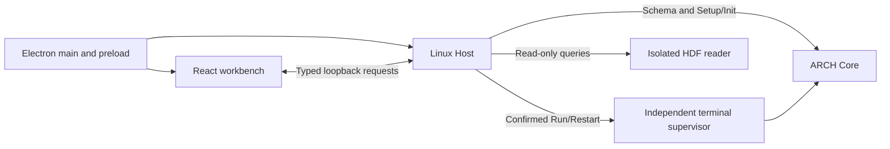

# ARCH Studio — Linux / WSL desktop

ARCH Studio edits research configurations, builds selected cases and displays initial states and read-only Plotfiles. The scientific Core stays on Linux. Start with the [user guide](../docs/guides/Studio.zh-CN.md) ([English](../docs/guides/Studio.md)); implementation boundaries are in the [Core API](../src/api/README.md) and [Host Plotfile contract](docs/contracts/PLOTFILE_AUDIT_API.md).

## Build and launch

Core-only builds do not require Node or Electron. To build the desktop with the Core:

```bash
cmake --preset studio-cpu-release -DARCH_STUDIO_NODE=/absolute/path/to/node
cmake --build build-studio-cpu --parallel 2
build-studio-cpu/bin/arch-studio --project "$PWD" --binary build-studio-cpu/bin/ARCH --case Sod --config simulation/Sod/Sod.par
```

This generates a source-checkout launcher. It requires this checkout; it is not a portable distribution. The opt-in Studio target installs locked npm dependencies and builds production assets, including the Linux Electron runtime. Linux Node 24+ is required; Run/Restart also need `xterm` and `/usr/bin/flock`. WSL needs working WSLg. See [desktop lifecycle and packaging](desktop/README.md).

The development equivalent is `npm ci && npm run build` in this directory, then `desktop/arch-studio` with the same arguments. Put Node 24+ on PATH or set `ARCH_STUDIO_NODE` to its absolute executable. An explicit invalid Node path is an error. The desktop selects its internal loopback connections; users do not copy an IP/port or start Vite.

## Workflow and capability

The selected binary supplies the configuration schema, registered cases and Preview capabilities. Parameter edits may be previewed without Save; Run/Restart require an associated saved input and explicit confirmation. Changing C++ requires Configure/Build before its code can affect Preview or Run. Incomplete build-dependency evidence stays unknown rather than being accepted as fresh.

Initial fields use the case's real Setup/Init and shared EOS conversion. Initial AMR is a separate bounded request, overlaid on matching fields. Native-coordinate slices support the dimensions advertised by each case. Registration alone does not enable Preview: new cases need complete input declarations and reviewed sampling/AMR capabilities. Custom units are reviewed evidence tied to source identity; automatic inference of arbitrary C++ expressions is not implemented.

The Plotfile workspace reads completed published files. Display overviews cover Cartesian 1D/2D active leaves. Stored-cell queries use recorded native coordinates for Cartesian, spherical and cylindrical 1D–3D charts, including axisymmetric cylindrical `(r,z)`. Native bounds, volume/torque measures, field units and typed provenance are retained. Curved/3D rendering remains a separate capability; query support does not imply a rendered view. XDMF, a reusable spatial index and a bounded cross-query cache are not claimed here.

## Source and evidence layout

| Location | Purpose |
| --- | --- |
| `src/components`, `src/data`, `src/state` | Renderer, display transformations and edit/request identity; no scientific solver |
| `src/host` | Browser-side typed contracts, validation and Host clients; no Node process access |
| `host/` | Linux service: project files, Core requests, build evidence, owned runs and isolated HDF reads |
| `desktop/` | Electron window, bootstrap and Linux packaging; run supervision stays with Host |
| [tests/](tests/README.md) | Engineering tests, fixtures and standalone test tools |
| [docs/contracts/](docs/contracts/PLOTFILE_AUDIT_API.md) | Maintained Host interface documentation |
| [docs/archive/](../docs/histroy/README.md#studio) | Historical Phase/QA/UAT records |
| [validation/](../validation/README.md) | Scientific references and reproduction tools |



## Current qualification

The [release plan](../ARCH_RELEASE_PLAN.md) is the single progress and qualification index. Native cylindrical CPU/Device integration and the scoped CUDA source-energy correction have accepted evidence there. Original CPU qualification limits, final distribution checks and human WSLg foreground acceptance remain explicit; automated Node/HTTP tests do not establish those outcomes. Historical test counts describe their original source identity, not the current suite.

For a source change, find its process owner in the table, follow the typed request to its validator and producer, then extend the corresponding [existing test](tests/README.md). Preview uses Core Setup/Init and shared EOS conversion; Run/Restart invoke the production program. Plotfile readers preserve stored values. Keep these responsibilities separate when adding a file, cache or numerical explanation.

Current integration is on `compute/optim`. The [feature list](../docs/Features.md) records supported model/backend combinations; past GUI delivery branches are historical evidence.

Environment prerequisites and installation: [Linux/WSL setup](../docs/guides/StudioEnvironment.md).
