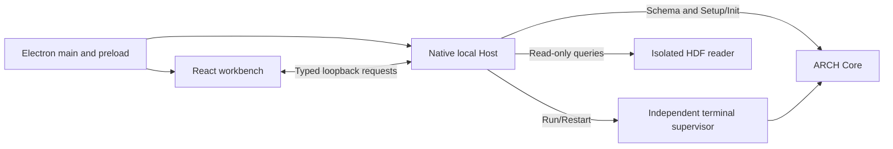

# ARCH Studio

[User guide](../docs/guides/Studio.md) · [中文使用指南](../docs/guides/Studio.zh-CN.md) · [Build](../docs/guides/Build.md#studio-desktop) · [Tests](tests/README.md)

Studio is the Linux/WSL2 and Windows desktop workbench for ARCH. It edits configurations, builds selected cases, previews initial fields and AMR, manages Run/Restart, and reads Plotfiles. This page describes the implementation; installation and everyday operation are covered by the linked guides.

## Source layout

| Location | Responsibility |
| --- | --- |
| `src/components`, `src/data`, `src/state` | Renderer, display transforms, working-copy state and request identity |
| `src/host` | Typed browser contracts, validation and Host clients |
| `host/` | Project files, Core requests, build evidence, owned runs and isolated HDF5 reads |
| `desktop/` | Electron window, bootstrap, native dialogs and portable packaging |
| [tests/](tests/README.md) | Engineering tests and small fixtures |
| [contracts](docs/contracts/PLOTFILE_AUDIT_API.md) | Host query and data semantics |



## Data and lifecycle

The selected binary supplies model registration, parameter schema and Preview capabilities. Preview uses Core Setup/Init and the shared EOS conversion; Run/Restart launches the production program. Parameter edits remain in a Working Copy until saved. Executing a run requires its saved project input and a matching executable.

Configure and Build validate the selected source/build/output bindings. Build records the available compiler, input and runtime evidence. Partial coverage is shown as unknown. Windows tool settings are provided privately by Electron Main and checked at the Host boundary.

Plotfile queries retain stored FP64 values, native coordinates, units and provenance. Display overviews support Cartesian 1D/2D and cylindrical r-z; stored-cell queries support the recorded native 1D–3D charts. The Inspector reports native cells, while LOD provides a display overview.

Closing the desktop cancels Preview and Configure requests and drains the Host. An active Build can finish; confirmed Run/Restart jobs have independent terminal supervision and remain running. [Desktop implementation](desktop/README.md) describes the launch and package boundaries.

## Development

Use native Node 24+ and the locked dependencies:

```bash
npm ci
npm test
npm run lint
npm run build
```

Run these commands in `studio/`. `npm run build` includes TypeScript checking. The [test guide](tests/README.md) covers required Host tools, native tests and desktop checks. Follow the typed request from its renderer client through its validator and producer when changing a workflow.
